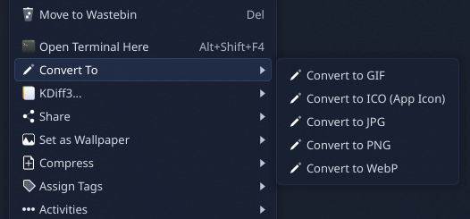

# KDE Image Converter

A KDE service menu that adds a **Convert To** submenu when right-clicking image files in Dolphin.



## Features

Right-click any supported image to convert it to:

- **JPG** — flattens transparency with a white background
- **PNG**
- **WebP** — at 85% quality
- **GIF**
- **ICO (App Icon)** — multi-resolution icon with sizes 256, 64, 48, 32, and 16 px

Multiple files can be selected and converted at once.

## Requirements

- KDE Plasma (Dolphin file manager)
- [ImageMagick](https://imagemagick.org/) (`convert` command)

## Installation

```bash
git clone https://github.com/bassidus/kde-image-converter
cd kde-image-converter
bash install.sh
```

This copies `convert.desktop` to `~/.local/share/kio/servicemenus/`. No restart required — Dolphin picks it up automatically.

## Uninstall

```bash
rm ~/.local/share/kio/servicemenus/convert.desktop
```
